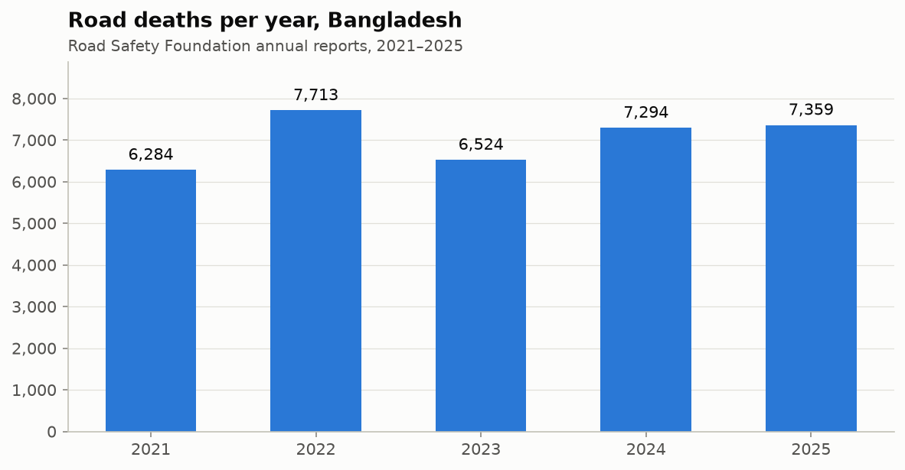
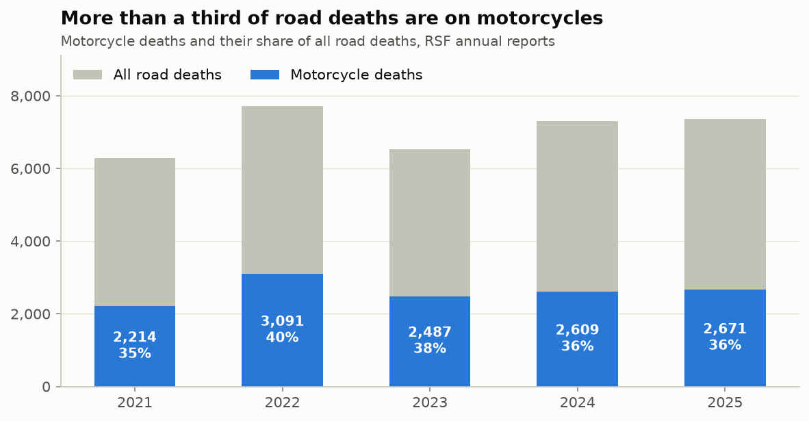
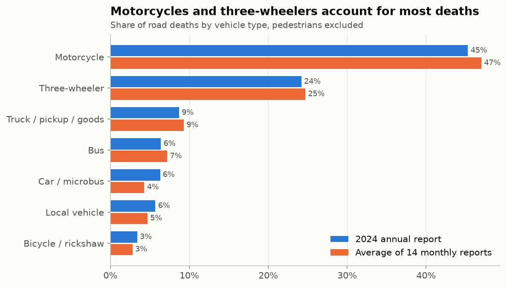
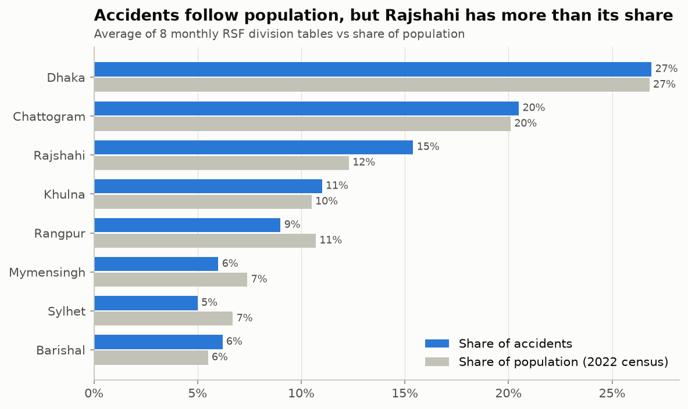
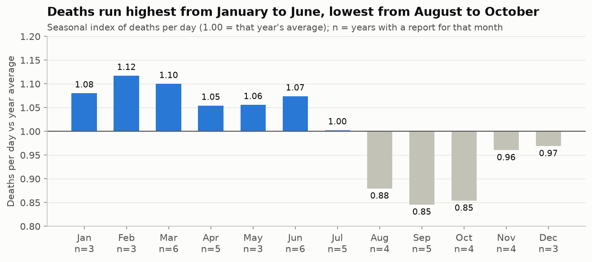

# BD-Road-Accident

Road accidents in Bangladesh from **January 2021 to September 2026**: data collection, cleaning and analysis in
Jupyter notebooks.



## Data

All figures are from the **Road Safety Foundation (RSF)**, a Bangladeshi NGO that counts road accidents reported by
national newspapers, online portals and TV, and publishes monthly and annual reports. RSF does not publish a
downloadable dataset, so the numbers are transcribed from the press articles that reproduce its reports.

| Source | Used for |
|---|---|
| [Deadly Roads: Bangladesh 2000–2025](https://github.com/ahasan722/bangladesh-road-crashes-2000-2025) (CC BY 4.0) | Most RSF annual, monthly and breakdown figures, each with its press citation |
| `data/raw/rsf_manual_additions.csv` | Extra RSF months for 2021–2022, checked against the original articles |
| BBS Census 2022 | Population by division |

Every row in `data/processed/` has a `source` and a `source_url` column pointing to the article it came from.

### Processed tables

| File | Contents |
|---|---|
| `monthly_national.csv` | Accidents, deaths, injuries per month (69 months; 49 with a report) |
| `annual_national.csv` | Annual totals 2021–2025, plus a partial 2026 |
| `vehicle_deaths.csv` | Deaths by vehicle type (motorcycle, three-wheeler, bus, truck, ...) |
| `division.csv` | Accidents, deaths or share of accidents by division |
| `time_of_day.csv` | Share of accidents by time of day |
| `eid_periods.csv` | Accidents and deaths during Eid travel windows |

## Notebooks

1. [`notebooks/01_data_cleaning.ipynb`](notebooks/01_data_cleaning.ipynb): loads the raw files, fixes wrong
   years, removes duplicates and other organisations' figures, checks coverage and consistency, and writes the
   processed tables.
2. [`notebooks/02_analysis.ipynb`](notebooks/02_analysis.ipynb): deaths by year, vehicle type, division, month,
   season, Eid and time of day.

## Key findings

- Road deaths rose from **6,284 (2021) to 7,359 (2025)**, about 20 a day. 2026 is running about 15% lower than
  2025 for the same months.
- **Motorcycles account for 35–40% of all road deaths** every year. Three-wheelers come second.
- Accidents broadly follow population across divisions. **Dhaka** has the most, and **Rajshahi** has more than its
  population share would suggest.
- Deaths per day are **highest from January to July** and lowest from August to October. **Eid travel** windows
  have 26–51% more deaths per day than normal.

| | |
|---|---|
|  |  |
|  |  |

## Limitations

- RSF counts **media-reported** accidents only, so the real toll is higher. The WHO's modelled estimate for 2021 is
  about five times RSF's count.
- 20 of the 69 months have no RSF report that could be confirmed.
- Full vehicle-type and division tables exist only for the months the press reproduced them.

## Run it

```bash
git clone https://github.com/MehrazRumman/BD-Road-Accident.git
cd BD-Road-Accident
python -m venv .venv && source .venv/bin/activate
pip install -r requirements.txt
jupyter notebook notebooks/
```

Run `01_data_cleaning.ipynb` first, then `02_analysis.ipynb`.
